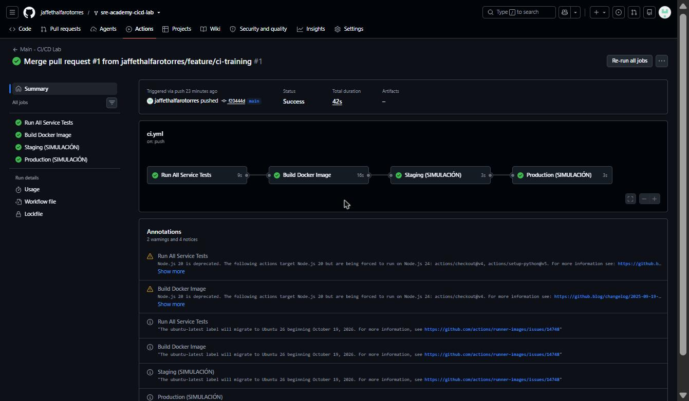

# Entrega: Laboratorio CI/CD con GitHub Actions

**Estudiante:** Jaffeth Alfaro Torres
**Programa:** IBM SRE Academy
**Repositorio base:** [aromero15/sre-academy-cicd-lab](https://github.com/aromero15/sre-academy-cicd-lab)

## Resultado final

Pipeline en `main`: **test -> build -> deploy-staging -> deploy-production**, todos en verde (42 s).

## Qué se hizo

| Paso | Detalle |
|------|---------|
| Fork y rama | Fork del repo de laboratorio y rama `feature/ci-training` desde `main` |
| Actividad A | `.github/workflows/pr.yml`: valida Pull Requests hacia `main` (`opened`, `synchronize`, `reopened`) |
| Prueba de fallo | En `tests/test_tasks.py` se cambió el status esperado de 200 a 500: el check falló (`assert 200 == 500`, 1 failed, 19 passed). Luego se restauró a 200 y volvió a verde |
| Actividad B | `.github/workflows/ci.yml`: al hacer push a `main` corre test -> build -> staging -> production encadenados con `needs` |
| Merge | PR #1 mergeado a `main` del fork con todos los checks en verde |

## Enlaces

- [PR #1 (checks fallido y luego en verde)](https://github.com/jaffethalfarotorres/sre-academy-cicd-lab/pull/1)
- [Ejecuciones en Actions](https://github.com/jaffethalfarotorres/sre-academy-cicd-lab/actions)
- [Guía visual paso a paso (PDF)](SRE-Academy-CICD-Visual-Guide.pdf)

## Respuestas a las preguntas de las plantillas

- **¿Por qué `pr.yml` no debería desplegar a producción?** Solo valida el PR con pruebas; no tiene job de despliegue. Nada debe llegar a producción antes de la revisión y el merge a `main`.
- **¿Qué pasaría sin los `needs` en `ci.yml`?** Los 4 jobs correrían en paralelo; staging y production "desplegarían" aunque fallaran las pruebas o el build.

## Contenido de esta carpeta

- `final-result-pipeline.jpg`: captura del resultado final
- `SRE-Academy-CICD-Visual-Guide.pdf`: guía visual (15 pasos con capturas)
- `SRE-Academy-CICD-Visual-Guide.html`: la misma guía en HTML (descargar y abrir en el navegador)
